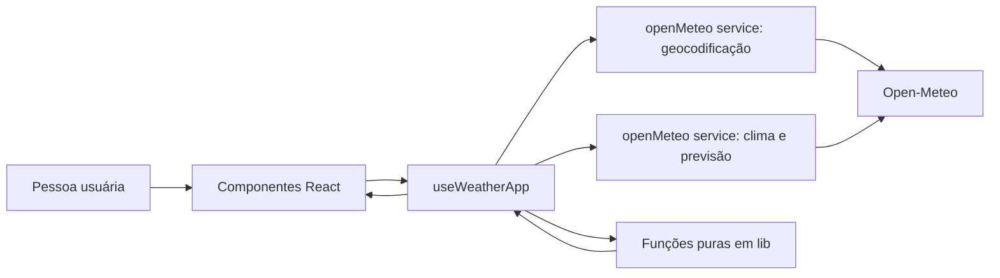
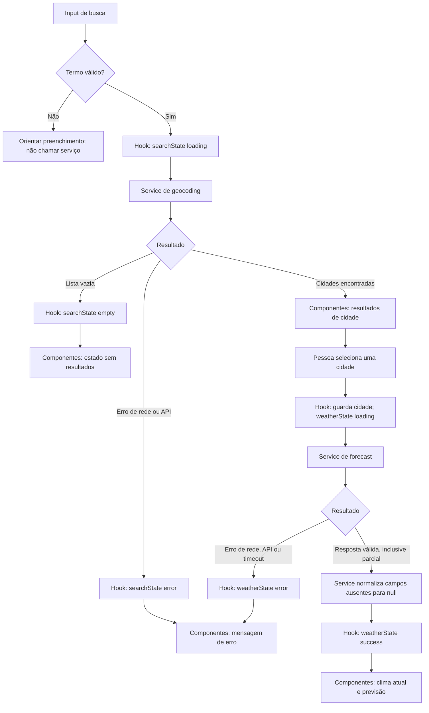

# Plano Técnico — Weather App

Este plano deriva de `specs/weather-app-spec.md`. As decisões marcadas como
pendentes dependem das Open Questions (OQ) da spec e devem ser fechadas antes
das tarefas que as consomem. Este documento define arquitetura e contratos; não
implementa o produto.

## Architecture

Aplicação SPA cliente-side em React, organizada em quatro camadas com
dependências em uma direção: `components` → `hooks` → `services` → APIs
externas. `lib` contém funções puras usadas pelas camadas superiores, sem
depender de React, rede ou estado global. Componentes não montam URLs nem
interpretam diretamente o formato externo.



Responsabilidades e fronteiras de teste:

- **`components/` — apresentação:** recebe dados e callbacks por props; renderiza
  busca, resultados, clima, previsão, unidade e estados loading/empty/error. Não
  importa serviços nem conhece o schema Open-Meteo. Testar com Testing Library e
  `user-event`, verificando comportamento acessível sem rede.
- **`hooks/` — orquestração/estado:** coordena busca, seleção, consulta, unidade
  e estados assíncronos; chama serviços, usa `lib` e descarta respostas antigas.
  Testar isoladamente com serviços substituídos por mocks para cobrir transições
  de estado e concorrência.
- **`services/` — acesso a dados:** monta requests, trata status/JSON e mapeia
  respostas Open-Meteo para tipos internos. Não importa componentes ou hooks.
  Testar com `fetch` mockado, cobrindo URL, parâmetros, mapeamento e falhas.
- **`lib/` — funções puras:** contém conversões e formatação determinística; não
  importa React, `fetch` ou serviços. Testar por entradas e saídas, sem DOM,
  mocks ou configuração de rede.

Tipos compartilhados ficam em `types/`; essa pasta contém contratos, não lógica.
`app/` é o ponto de composição que conecta o hook aos componentes.

O cliente consulta a Open-Meteo diretamente: a spec não prevê backend,
autenticação ou persistência em servidor. Não adicionar camada de servidor ou
biblioteca de estado global sem requisito que a justifique.

## Tech Stack

| Área | Decisão | Justificativa |
|---|---|---|
| Linguagem | TypeScript strict | Tipos para contratos internos e respostas externas parcialmente confiáveis. |
| UI | React 19 + Vite | Já definidos e instalados no projeto; adequados a uma SPA sem backend. |
| Estilo | Tailwind CSS | Stack já configurada no repositório. |
| Estado | React `useState` e um hook de orquestração | O fluxo é local à página e não requer estado global compartilhado entre rotas. |
| API | `fetch` nativo | Open-Meteo não exige chave; evita dependência adicional para poucas operações. |
| Testes | Vitest, Testing Library, user-event e Playwright | Ferramentas presentes no projeto para testes unitários, de componente e E2E. |
| Qualidade | Biome | Lint e formatação já configurados no repositório. |

As versões exatas devem continuar alinhadas a `package.json` e ao lockfile.

## Project Structure

Estrutura proposta; o repositório ainda não contém `src/` nem `tests/`:

```text
src/
  app/
    App.tsx                 composição da página e ligação ao hook
  components/
    CitySearch.tsx          entrada e envio da busca
    CityResults.tsx         opções de cidade retornadas
    CurrentWeather.tsx      apresentação do clima atual
    Forecast.tsx            apresentação da previsão
    TemperatureUnitToggle.tsx controle Celsius/Fahrenheit
    QueryStatus.tsx         loading, vazio e erro
  hooks/
    useWeatherApp.ts        estado e orquestração dos fluxos
  services/
    openMeteo.ts            chamadas HTTP e mapeamento das respostas
  types/
    weather.ts              tipos de domínio e estados de consulta
  lib/
    temperature.ts          conversão pura Celsius/Fahrenheit
    localization.ts         formatação conforme regras aprovadas
tests/
  unit/
    services/openMeteo.test.ts
    lib/temperature.test.ts
  components/
    CitySearch.test.tsx
    QueryStatus.test.tsx
  e2e/
    weather-app.spec.ts
```

Manter cada componente focado em uma responsabilidade. Não criar hooks,
componentes ou módulos para abstrações usadas por apenas uma chamada simples.

## Data Model

Tipos de domínio normalizados a partir dos campos Open-Meteo. O contrato abaixo
propõe a seleção de campos meteorológicos para a aplicação; a aprovação final
depende de OQ1. `ForecastDay` assume granularidade diária; se OQ2 escolher
previsão horária, o contrato do forecast deverá ser revisto.

```ts
export type Unit = "celsius" | "fahrenheit";

export interface City {
  id?: number; // Identificador da localidade retornado pelo Geocoding API.
  name: string; // Nome da cidade retornado pela API.
  latitude: number; // Latitude usada nas consultas de previsão.
  longitude: number; // Longitude usada nas consultas de previsão.
  country?: string; // País, para distinguir resultados homônimos.
  region?: string; // Região administrativa, normalmente admin1.
  timezone?: string; // Fuso IANA retornado pelo geocoding, quando disponível.
}

export interface CurrentWeather {
  observedAt: string; // Horário de current.time em ISO 8601.
  temperatureC: number | null; // current.temperature_2m, em graus Celsius.
  apparentTemperatureC: number | null; // current.apparent_temperature, em graus Celsius.
  relativeHumidityPercent: number | null; // current.relative_humidity_2m, em porcentagem.
  weatherCode: number | null; // current.weather_code, código WMO de condição.
  precipitationMm: number | null; // current.precipitation, em milímetros.
  windSpeedKmh: number | null; // current.wind_speed_10m, em km/h.
  windDirectionDegrees: number | null; // current.wind_direction_10m, em graus.
  pressureMslHpa: number | null; // current.pressure_msl, em hPa.
  isDay: boolean | null; // current.is_day: 1 para dia, 0 para noite.
}

export interface ForecastDay {
  date: string; // daily.time no formato YYYY-MM-DD do fuso solicitado.
  minimumTemperatureC: number | null; // daily.temperature_2m_min, em graus Celsius.
  maximumTemperatureC: number | null; // daily.temperature_2m_max, em graus Celsius.
  weatherCode: number | null; // daily.weather_code, código WMO de condição.
  precipitationSumMm: number | null; // daily.precipitation_sum, em milímetros.
  precipitationProbabilityMaxPercent: number | null; // daily.precipitation_probability_max, em porcentagem.
}

export interface WeatherData {
  city: City; // Cidade selecionada para a consulta.
  timezone: string; // Fuso usado para interpretar as datas da previsão.
  fetchedAt: string; // Horário local em que a resposta foi recebida, em ISO 8601.
  current: CurrentWeather; // Condições atuais normalizadas.
  forecastDays: ForecastDay[]; // Dias retornados para hoje e os quatro dias seguintes.
}

type QueryErrorKind = "network" | "api" | "timeout" | "invalid-response" | "unknown";

type QueryState<T> =
  | { status: "idle" }
  | { status: "loading" }
  | { status: "success"; data: T }
  | { status: "empty" }
  | { status: "error"; kind: QueryErrorKind; message: string };
```

Contratos importantes:

- `City` guarda coordenadas retornadas pelo geocoding; a interface usa os
  atributos de desambiguação aprovados em OQ3.
- Os timestamps são ISO 8601. O formato apresentado e a regra de fuso dependem
  de OQ7 e OQ11.
- O serviço normaliza campos numéricos esperados ausentes para `null`; a
  apresentação mostra “—” para esses campos, conforme AC2.3 e AC3.3.
- Valores de temperatura ficam em Celsius no modelo interno. `lib/temperature`
  converte para a unidade escolhida; a apresentação apenas renderiza o valor
  formatado, sem nova requisição (RF4).
- Os nomes normalizados ocultam os nomes da API; o serviço faz o mapeamento e
  valida os tipos antes de produzir `WeatherData`.

## Data Flow



O hook inicia cada operação e guarda seu estado; os serviços devolvem dados ou
erro tipado. Geocoding vazio não chama forecast nem substitui a cidade atual.
Respostas parciais válidas chegam à UI como sucesso, com campos ausentes em
`null` para exibição de “—”. Ao selecionar outra cidade, respostas obsoletas
são descartadas (AC2.2). A unidade passa por `lib/temperature` na renderização;
alterná-la não chama novamente a API (AC4.2–AC4.4).

## External APIs

### Geocoding

- **URL:** `https://geocoding-api.open-meteo.com/v1/search`
- **Método:** `GET`
- **Parâmetros:** `name` (termo pesquisado), `count=10` (limite proposto de
  resultados), `language=pt` e `format=json`. O limite e os atributos de
  desambiguação devem ser revistos ao fechar OQ3.
- **Exemplo resumido de resposta:**

```json
{
  "results": [
    {
      "id": 6322752,
      "name": "Campinas",
      "latitude": -22.9056,
      "longitude": -47.0608,
      "country": "Brazil",
      "admin1": "São Paulo",
      "timezone": "America/Sao_Paulo"
    }
  ]
}
```

- **Mapeamento para `City`:** `id` → `id`; `name` → `name`; `latitude` e
  `longitude` → coordenadas; `country` → `country`; `admin1` → `region`;
  `timezone` → `timezone`. Propriedades que a resposta não trouxer permanecem
  opcionais. `results: []` mapeia para estado `empty`, não erro.

### Forecast

- **URL:** `https://api.open-meteo.com/v1/forecast`
- **Método:** `GET`
- **Parâmetros:** `latitude` e `longitude` da cidade selecionada;
  `current=temperature_2m,apparent_temperature,relative_humidity_2m,weather_code,precipitation,wind_speed_10m,wind_direction_10m,pressure_msl,is_day`;
  `daily=weather_code,temperature_2m_min,temperature_2m_max,precipitation_sum,precipitation_probability_max`;
  `timezone=auto` (proposta: fuso local da cidade, pendente de OQ7);
  `forecast_days=5`; `temperature_unit=celsius`; `wind_speed_unit=kmh`;
  `precipitation_unit=mm`. A seleção de campos depende da aprovação de OQ1 e
  OQ2; `daily` assume previsão diária.
- **Exemplo resumido de resposta** (arrays diários alinhados pelo índice):

```json
{
  "timezone": "America/Sao_Paulo",
  "current": {
    "time": "2026-10-27T09:00",
    "temperature_2m": 18.4,
    "apparent_temperature": 18.1,
    "relative_humidity_2m": 72,
    "weather_code": 3,
    "precipitation": 0.0,
    "wind_speed_10m": 8.2,
    "wind_direction_10m": 140,
    "pressure_msl": 1015.2,
    "is_day": 1
  },
  "daily": {
    "time": ["2026-10-27", "2026-10-28", "2026-10-29", "2026-10-30", "2026-10-31"],
    "weather_code": [3, 2, 61, 3, 1],
    "temperature_2m_min": [16.0, 17.0, 18.0, 16.0, 15.0],
    "temperature_2m_max": [25.0, 26.0, 23.0, 24.0, 25.0],
    "precipitation_sum": [0.0, 0.0, 4.2, 0.0, 0.0],
    "precipitation_probability_max": [5, 10, 70, 15, 5]
  }
}
```

- **Mapeamento para `CurrentWeather`:** `current.time` → `observedAt`;
  `temperature_2m` → `temperatureC`; `apparent_temperature` →
  `apparentTemperatureC`; `relative_humidity_2m` → `relativeHumidityPercent`;
  `weather_code` → `weatherCode`; `precipitation` → `precipitationMm`;
  `wind_speed_10m` → `windSpeedKmh`; `wind_direction_10m` →
  `windDirectionDegrees`; `pressure_msl` → `pressureMslHpa`; `is_day` (0/1) →
  `isDay` (false/true).
- **Mapeamento para `ForecastDay`:** percorrer os arrays de `daily` pelo mesmo
  índice; `time` → `date`; `temperature_2m_min`/`temperature_2m_max` →
  `minimumTemperatureC`/`maximumTemperatureC`; `weather_code` → `weatherCode`;
  `precipitation_sum` → `precipitationSumMm`;
  `precipitation_probability_max` → `precipitationProbabilityMaxPercent`.
- **Mapeamento para `WeatherData`:** cidade selecionada → `city`; `timezone` da
  resposta → `timezone`; horário de recebimento registrado pelo cliente →
  `fetchedAt`; objeto `current` mapeado → `current`; arrays diários mapeados →
  `forecastDays`.
- **Unidades e ausências:** solicitar Celsius, km/h e mm, convertendo as
  temperaturas para Fahrenheit apenas na apresentação. Se um campo esperado
  estiver ausente ou vier `null`, normalizá-lo para `null` no tipo e exibir “—”.
  A troca de `Unit` não provoca novo request.
- **Proteção de dados parciais:** aplicar o inventário de nulabilidade da spec
  aos campos consumidos. Reutilizar a validação de data de `lib/format` no
  mapeamento diário; rejeitar estrutura, horário, fuso ou datas inválidos antes
  da renderização. Omitir textos opcionais vazios do geocoding e validar nome
  e limites das coordenadas. Lista não vazia sem cidades válidas é erro.
  Formatadores, conversão e códigos WMO defendem também contra `undefined` e
  valores não finitos; overflow de conversão resulta em `null`. Componentes
  preservam zero, usam “—” para ausência e não geram `<time>` inválido.
- **Erros:** resposta válida sem resultados de geocoding é `empty`; falha HTTP,
  rede, timeout ou JSON inválido é `error`. O timeout e eventual retry/cache
  seguem OQ6.

O exemplo diário é uma proposta para o contrato atual e não resolve OQ1/OQ2.
Se OQ2 aprovar previsão horária, os parâmetros `daily`, o tipo `ForecastDay` e
os critérios correspondentes deverão ser substituídos pelo contrato horário.

## State Management

Para feedback acessível, `App` deriva `aria-busy` do status e observa a
transição de loading para um estado concluído para focar o `main` existente
(`tabIndex=-1`). Preserva foco em outros controles, inclusive o toggle de
unidade. Loading continua com `role=status`. Hover de busca só se aplica quando
habilitada; hover da unidade selecionada mantém fundo de destaque.
Não adicionar memoização especulativa: há apenas cinco cards, formatadores Intl
já são compartilhados e a edição da busca é estado local. Medir com Profiler
antes de introduzir `memo`/`useMemo`/callbacks estáveis.

O estado da tela vive em `useWeatherApp`; componentes recebem valores e ações
por props e não mantêm cópias de dados de API. O hook mantém:

- `searchQuery: string` — texto editável da busca;
- `searchState: QueryState<City[]>` — resultados e estado da geocodificação;
- `selectedCity: City | null` — localização ativa;
- `weatherState: QueryState<WeatherData>` — clima atual e previsão da cidade;
- `unit: Unit` — unidade selecionada, iniciando em Celsius quando não há
  preferência disponível.

Cada consulta segue os estados explícitos `idle → loading → success`,
`idle/loading → empty` para geocodificação sem resultados, ou
`idle/loading → error` para falhas. `empty` é resultado válido da busca, não
erro meteorológico. Ao selecionar outra cidade, o hook aborta a consulta
anterior quando possível e ignora qualquer resposta obsoleta.

Os dados meteorológicos guardados em `weatherState` permanecem canônicos em
Celsius. No render, os valores numéricos não nulos passam por
`lib/temperature.convertTemperature(valueC, unit)`; `null` continua indisponível
e é exibido como “—”. A conversão é derivada, não gravada em estado separado, e
a troca de `unit` não chama serviço nem dispara request (AC4.2–AC4.4). Assim,
uma renderização posterior sempre deriva do valor original e não acumula erro de
conversão.

Não introduzir Redux, Zustand, React Query ou persistência local nesta fase. A
persistência da unidade após recarga depende de OQ5; cache e retry dependem de
OQ6.

## Error Handling

- **Rede (`kind: "network"`):** falha de conexão ou `fetch` rejeitado. Encerrar
  loading e exibir mensagem de que não foi possível conectar; não classificar
  como busca sem resultados.
  No serviço, o helper compartilhado `fetchJsonWithTimeout` converte falhas de
  transporte, inclusive durante a leitura do corpo, em `WeatherServiceError`.
  A mensagem orienta verificar a conexão e tentar novamente.
- **API (`kind: "api"`):** resposta HTTP não-2xx ou erro explícito do provedor.
  Encerrar loading e informar que o serviço não concluiu a consulta; não expor
  detalhes internos da resposta ao usuário.
- **Timeout (`kind: "timeout"`):** distinguir o cancelamento por prazo excedido
  de cancelamento manual por troca de cidade. Encerrar loading e exibir mensagem
  de demora/falha. Conforme OQ6, `fetchJsonWithTimeout` usa
  `AbortController` com prazo de 10 segundos, centralizado no serviço para
  geocodificação e forecast, incluindo a leitura do JSON. Converte o aborto
  em `WeatherServiceError`, informa o limite de 10 segundos e executa
  `clearTimeout` no `finally`.
- **Retry manual:** `useWeather` guarda a última operação do usuário e seus
  argumentos; `retry` repete a busca completa ou somente o forecast da cidade
  selecionada. `ErrorState` chama essa ação; loading remove o botão. Não há
  retry automático. O identificador de request protege também novas tentativas.
  Mensagens amigáveis são compartilhadas por categoria entre serviço e hook;
  diagnósticos técnicos não são exibidos pela interface.
- **Resposta inválida (`kind: "invalid-response"`):** JSON inválido ou estrutura
  incompatível com o contrato. Encerrar loading e informar falha de leitura dos
  dados; registrar diagnóstico técnico sem exibir payload ao usuário.
- **Erro inesperado (`kind: "unknown"`):** falha fora das categorias normalizadas
  pelo serviço. Exibir mensagem genérica, sem propagar detalhes internos.
- **Sem resultados:** geocoding bem-sucedido com `results: []` produz `empty`,
  não dispara forecast e não é apresentado como erro (AC1.3, AC5.3).
- **Resposta parcial:** quando a estrutura geral é válida mas um campo esperado
  está ausente ou `null`, preservar os demais campos e normalizar o ausente para
  `null`; a UI mostra “—” sem falhar (AC2.3, AC3.3). Ausência da estrutura
  obrigatória, como `current` ou `daily`, é `invalid-response`.
- **Mudança de cidade durante request:** usar `AbortController` ou identificador
  de request para impedir que resposta obsoleta atualize a UI. Cancelamento
  intencional não deve gerar mensagem de erro.
- **Dados anteriores:** em erro, não apresentá-los como atuais. Cache e eventual
  indicação de dados anteriores dependem de OQ6.
- **Falha externa:** a meta de disponibilidade e a contingência para Open-Meteo
  dependem de OQ10.

## Testing Strategy

- **Vitest — `lib/`:** testar conversão Celsius→Fahrenheit e Fahrenheit→Celsius
  com os valores de AC4.2/AC4.3; confirmar que `null` permanece indisponível e
  que valores de origem não são alterados. Testes puros, sem DOM, rede ou mocks.
- **Vitest — `services/`:** mockar `fetch` e verificar URL/parâmetros dos dois
  endpoints, mapeamento para tipos internos, arrays diários alinhados por índice,
  `results: []`, campos parciais, status HTTP não-2xx, erro de rede, JSON
  inválido, timeout e cancelamento. Nenhum teste unitário chama Open-Meteo real.
- **Vitest + Testing Library — `hooks/`:** verificar os estados `idle`,
  `loading`, `success`, `empty` e `error`; selecionar uma cidade; garantir que
  mudança de cidade invalida resposta anterior; garantir que mudar unidade não
  chama os serviços novamente.
- **Testing Library — `components/`:** testar sucesso, loading, vazio e erro nos
  componentes de busca/resultados e clima/previsão; input vazio; seleção de
  cidade; campos ausentes exibidos como “—”; rótulos e operação por teclado; e
  troca de unidade refletida em todos os valores visíveis. Usar `user-event`.
- **Playwright — fluxo E2E:** interceptar geocoding e forecast com fixtures e
  cobrir busca → seleção → clima atual/previsão → alternância C/F, sem depender
  da disponibilidade externa. Cobrir também cidade sem resultados e falha de
  API visível ao usuário.
- **Playwright — viewports:** executar o fluxo principal em 320 px, 768 px e
  1280 px, correspondentes a RNF1; verificar ausência de rolagem horizontal,
  acesso aos controles e possibilidade de concluir busca e troca de unidade.
  Incluir ao menos um cenário de teclado nos fluxos principais (RNF2).
- **Rastreabilidade:** nomear os testes pelos IDs AC1.1–AC5.4 e associar cada
  cenário aos RFs/RNFs da matriz em `specs/weather-app-spec.md`.
- **OQs pendentes:** fechar fixtures e expectativas de campos após OQ1/OQ2; datas
  e timezone após OQ7; navegador/ambiente após OQ8; metas de desempenho após OQ9.
  Timeout e recuperação automatizados seguem o valor aprovado em OQ6.

## Risks & Trade-offs

| Decisão | Alternativa considerada | Trade-off aceito |
|---|---|---|
| Estado em React local (`useState` + `useWeatherApp`) | Redux/Zustand ou React Query | Menos dependências e fluxo suficiente para uma tela; cache, retry e revalidação não vêm prontos e dependem de OQ6. |
| Acesso direto à Open-Meteo pelo browser via `fetch` | Backend/proxy ou cliente HTTP adicional | Não exige infraestrutura nem segredo de API para o escopo atual; latência/disponibilidade dependem do provedor, e mapeamento/erros ficam sob responsabilidade do serviço. |
| Tipos internos normalizados no serviço | Usar o JSON da Open-Meteo diretamente na UI | Componentes ficam isolados de mudanças externas e são fáceis de fixturear; há custo de mapeamento e manutenção quando OQ1/OQ2 forem decididas. |
| Temperaturas canônicas em Celsius, conversão derivada em `lib` | Solicitar cada unidade à API ou guardar valores convertidos | Unidade troca sem request e sem duplicar estado; exige conversão local e decisão posterior sobre arredondamento/formatação. |
| Testes de integração com `fetch` mockado e E2E com rotas interceptadas | Chamar Open-Meteo real em toda a suíte | Testes ficam determinísticos e independentes da rede; não medem disponibilidade real do provedor, que exige monitoramento separado se virar requisito. |
| Sem persistência/cache/retry definidos nesta etapa | Persistir preferência e implementar política de cache/retry agora | Evita adivinhar OQ5/OQ6; comportamento entre recargas e durante indisponibilidade permanece pendente até essas decisões. |
| Forecast diário como forma atual de `ForecastDay` | Modelo horário ou combinado | Mantém contrato simples para a previsão de cinco datas; pode exigir revisão do tipo e dos testes se OQ2 escolher outra granularidade. |

Riscos de produto que continuam pendentes: campos e granularidade (OQ1/OQ2),
desambiguação (OQ3), timeout/cache/retry (OQ6), fuso/atualidade (OQ7), matriz de
compatibilidade (OQ8) e metas de desempenho/disponibilidade (OQ9/OQ10).